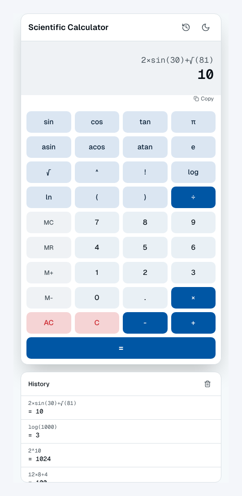

<div align="center">

# 🧮 Scientific Calculator (React + Next.js)

A responsive scientific calculator with full expression input, memory keys, a clickable history panel, keyboard support and light/dark themes.




</div>

> A desktop version written in Python and Tkinter is in [Scientific-Calculator](https://github.com/ZainAftab-dev/Scientific-Calculator).

---

## Features

| Group | Keys |
|---|---|
| Arithmetic | `+` `-` `×` `÷`, brackets `(` `)`, decimals |
| Powers and roots | `^` (power), `√` (square root), `!` (factorial) |
| Trigonometry (degrees) | `sin`, `cos`, `tan`, `asin`, `acos`, `atan` |
| Logarithms | `log` (base 10), `ln` (natural log) |
| Constants | `π`, `e` |
| Memory | `MC`, `MR`, `M+`, `M-` (current memory value is shown above the keypad) |
| Editing | `AC` (clear all), `C` (delete last character) |

**Extras**
- Type a whole expression such as `2×sin(30)+√(81)` and see it above the result
- History panel: every calculation is saved; click an entry to load it again, or clear the list
- Copy the result to the clipboard with one click
- Light and dark themes
- Keyboard input (see below)
- Safe evaluation: the expression is translated to JavaScript `Math` calls and checked against a whitelist of characters before it runs

## Examples

| Input | Result |
|---|---|
| `12×8+4` | `100` |
| `2^10` | `1024` |
| `log(1000)` | `3` |
| `2×sin(30)+√(81)` | `10` |
| `asin(1)` | `90` |
| `5!` | `120` |

## Keyboard shortcuts

| Key | Action |
|---|---|
| <kbd>0</kbd>–<kbd>9</kbd>, <kbd>.</kbd> | Digits and decimal point |
| <kbd>+</kbd> <kbd>-</kbd> <kbd>*</kbd> <kbd>/</kbd> <kbd>^</kbd> | Operators |
| <kbd>(</kbd> <kbd>)</kbd> | Brackets |
| <kbd>Enter</kbd> or <kbd>=</kbd> | Calculate |
| <kbd>Backspace</kbd> | Delete last character |
| <kbd>Esc</kbd> | Clear all |

## Tech stack

| Layer | Tools |
|---|---|
| Framework | Next.js 16 (App Router), React 19 |
| Language | TypeScript |
| UI | Tailwind CSS 4, shadcn/ui, Lucide icons |

## Getting started

**Requirements:** Node.js 18.18 or newer.

```bash
git clone https://github.com/ZainAftab-dev/Scientific-Calculator-With-React.git
cd Scientific-Calculator-With-React
npm install
npm run dev
```

Open [http://localhost:3000](http://localhost:3000). For a production build: `npm run build` then `npm start`.

## Project structure

```
app/
├── layout.tsx               # root layout, fonts and metadata
├── page.tsx                 # renders <Calculator />
└── globals.css              # theme colours (light and dark)
components/
├── calculator.tsx           # state: input, result, memory, history, keyboard handling
└── calculator/
    ├── display.tsx          # expression and result
    ├── button-panel.tsx     # keypad layout
    ├── calc-button.tsx      # single key
    ├── history.tsx          # history list
    └── theme-toggle.tsx     # light/dark switch
lib/
└── calculator-engine.ts     # parses and evaluates expressions
```

## Deployment

Import the repository into [Vercel](https://vercel.com/new) and deploy with the default settings. No environment variables are needed.

## Author

**Zain Aftab** · [GitHub](https://github.com/ZainAftab-dev) · [LinkedIn](https://www.linkedin.com/in/zain-aftab-563727295/)

## License

[MIT](LICENSE)
